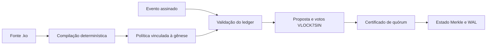

# Arquitetura e recursos da Konaet

A Konaet Soberana reúne identidade criptográfica, eventos assinados, estado
Merkle, consenso VLOCK7SIN, persistência e regras nativas `.ko`.

[Abrir console online](https://konaet-ko-runtime.alkalipixie.chatgpt.site) ·
[Baixar Konaet Console](https://github.com/7dsol3/konaet-sovereign-spec/releases/latest/download/Konaet-Console-Windows-x64.zip)

## Componentes executáveis

| Recurso | Funcionamento | Implementação |
|---|---|---|
| Linguagem `.ko` | Fonte compilado em regras determinísticas, com inteiros exatos e igualdade de hashes | [koPolicy.js](chain/vlock7sin-js/src/koPolicy.js) |
| Identidade da política | Fonte e programa vinculados à gênese v6 | [SovereignGenesis.js](chain/network/sovereign/SovereignGenesis.js) |
| Transações assinadas | Autorização Ed25519 e validação de quantidade, saldo, nonce, rede e raiz | [event.js](chain/vlock7sin-js/src/event.js) e [ledger.js](chain/vlock7sin-js/src/ledger.js) |
| Finalização VLOCK7SIN | Propostas, votos e certificado de quórum | [SovereignNode.js](chain/network/sovereign/SovereignNode.js) |
| Sincronização | Transporte WebSocket autenticado e recuperação da posição de peers | [VlockWebSocketTransport.js](chain/network/sovereign/VlockWebSocketTransport.js) |
| Persistência | WAL com integridade, snapshots e restauração do estado | [persistence.js](chain/vlock7sin-js/src/persistence.js) |
| Operadores | Identidade individual, configuração de malha privada e transporte mTLS | [runIndependentValidator.js](chain/scripts/runIndependentValidator.js) |
| Console Windows | Quatro processos validadores, contas de teste, transferências, histórico e execução `.ko` | [console.mjs](tools/console.mjs) |
| Console online | Compilação e execução de políticas pelo servidor, formulário e resultado por regra | [Usar agora](https://konaet-ko-runtime.alkalipixie.chatgpt.site) |

## Caminho de execução nativa

O ledger aplica as regras `.ko` na admissão do evento, na preparação e
confirmação do fechamento e na recuperação dos registros persistidos.
Assinatura, saldo e nonce são conferidos no mesmo caminho de execução.

## Começar a usar

- **Pelo navegador:** abra o console online, escolha os dados e execute a política.
- **No Windows:** extraia o aplicativo e abra `Iniciar-Konaet.bat`.
- **Pelo código:** execute `npm ci --ignore-scripts` e `npm start`.
- **Pela linha de comando:** consulte [Runtime .ko](KO-RUNTIME.md).
- **Para configurar operadores:** consulte [Operação](DEPLOYMENT.md).

O console online recebe o contexto informado pelo visitante. O console
Windows usa o estado da sua instância de demonstração e as transações
assinadas entre suas contas de teste.
