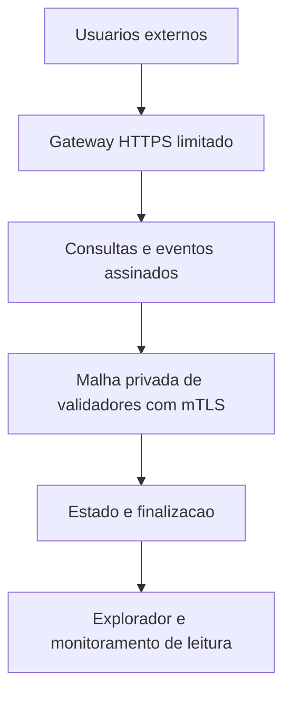

# Caminho de operação da Konaet Soberana

## Console pronto para executar

A edição 1.3.0 inclui os nós e o console. No Windows, extraia o asset
`Konaet-Console-Windows-x64.zip` e abra `Iniciar-Konaet.bat`. Pelo código,
use `npm ci --ignore-scripts` e `npm start` com Node.js 24.7+ da série 24.
Não é necessário criar um roster para essa demonstração.

O console gera quatro identidades de validador e duas contas de teste. São
quatro processos no mesmo computador, com uma gênese v6, política `.ko`,
listeners loopback e diretórios WAL individuais. Não representam quatro
operadores administrativamente independentes. O botão Encerrar console fecha
os processos; o próximo início recupera o mesmo estado. Não apague
`.konaet-demo/` se quiser preservar essa instância.

O aplicativo usa SND de demonstração. Não importa saldos de sua carteira,
não acessa SQL e não abre portas externas. O kit de operador é destinado à
configuração de máquinas separadas e exige um roster e certificados próprios.

## Operação entre máquinas

O código do runner fica em `chain/scripts/runIndependentValidator.js`.
As ferramentas de identidade e gênese estão em `chain/scripts/`. Cada operador
mantém seu diretório de chaves e seu WAL; o console de demonstração não é usado
como custódia de produção. A sequência abaixo descreve a publicação da rede.

## Arquitetura de entrada pública

É possível oferecer uma interface pública com validadores permissionados em
rede privada. A decisão sobre participação no consenso deve ser explícita.
O runner atual valida endereços privados e mantém `/status` e `/submit` em
loopback. Remover essas restrições não implementa uma entrada pública completa.

## Sequência de entrega

| Etapa | Artefato necessário | Critério de aceitação |
|---|---|---|
| 1. Identidade da instância | Gênese, versão, regras, ativo e hashes publicados | Todos os operadores usam os mesmos dados e sabem o que estão validando. |
| 2. Operadores | Instalações separadas, identidades próprias, certificados e procedimentos de custódia | Segredos sob controle de cada operador; nenhum pacote distribui chaves privadas. |
| 3. Malha | Comunicação privada/VPN e mTLS | Conexão autenticada; identidade incompatível rejeitada. |
| 4. Ensaio entre máquinas | Observações assinadas, falhas, recuperação e sincronização | Mesma raiz e posição após recuperação; falhas e divergências documentadas. |
| 5. Gateway | HTTPS, consultas, submissão assinada, limites e métricas | Aceitação diferenciada de finalização; abuso e indisponibilidade tratados. |
| 6. Explorador | Índice dos fechamentos VLOCK e provas | Dados do consenso soberano separados dos blocos SQL da aplicação. |
| 7. Faucet | Reserva e distribuição limitada da unidade escolhida | Débitos autorizados e rastreáveis, sem uso de contas existentes. |
| 8. Operação pública | Staging, revisão, backup, monitoramento e resposta | Exercícios concluídos e decisão de lançamento registrada. |

A gênese VLOCK observada é SND. Um faucet NAET requer primeiro definir como
NAET participa desse consenso ou assumir explicitamente que distribui somente
uma unidade SQL da aplicação. O nome do botão não altera a regra de execução.

## Proteção da instalação existente

- Usar gênese, chaves, diretórios e identificadores separados para uma nova
  instância de teste.
- Não importar saldos SQL como alocações de gênese sem uma política explícita
  de migração, verificação de oferta e prevenção de dupla contabilização.
- Não publicar credenciais, sessões, WALs de contas, backups, bancos ou seeds.
- Distribuir código e configuração pública; cada operador mantém seus segredos.

## Pendências registradas no workspace

A última avaliação local consultada registrou 26 verificações aprovadas e sete
dependências externas pendentes: custódia, pentest, staging, restauração de
backup, endurance de validadores, TURN e SFU. TURN/SFU servem voz e vídeo;
não são requisitos intrínsecos de finalização VLOCK.

O estado de uma edição documental não substitui esses critérios operacionais.
