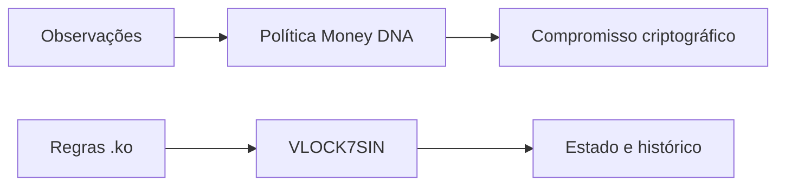

# Ecossistema Konaet

[Conhecer a apresentação](https://konaet-ko-runtime.alkalipixie.chatgpt.site) ·
[Executar .ko](https://konaet-ko-runtime.alkalipixie.chatgpt.site/console) ·
[Contato para projetos](https://wa.me/message/43CXZJ7NW2FPDO)

## Identidades dos ativos

| Ativo | Papel no sistema | Unidade e registro |
|---|---|---|
| **SINDRA · SND** | Unidade nativa da gênese VLOCK7SIN e sua política .ko | Gênese de um bilhão de SND; nove casas decimais |
| **NAET** | Unidade da aplicação Konaet, com envio, recebimento e histórico | Ledger Konaet; seis casas decimais |
| **Konaet Work · KWRK** | Unidade de trabalho registrada no ecossistema | Ledger Konaet; oito casas decimais |
| **Konaet Actum · KACT** | Unidade ligada à execução contabilizada pela aplicação | Ledger Konaet; nove casas decimais |

Cada identidade acompanha suas regras e sua autoridade de registro. O console
Windows demonstra operações SND em uma instância própria. Os diagramas
apresentam recursos e fluxos gerais, sem dados de contas da instalação.

## Money DNA

**8.888.888.888.888 unidades simbólicas de referência da política.**

Money DNA organiza observações e compromissos criptográficos. O número é a
capacidade de referência do modelo; possui significado distinto da emissão,
do saldo financeiro e da cotação dos ativos.

## Construir com a Konaet

Integrações, aplicações sob medida e pesquisa orientada a produto começam
pela definição do objetivo, dos dados, das permissões e das condições de
operação. Use o [contato do projeto](https://wa.me/message/43CXZJ7NW2FPDO)
para apresentar uma proposta.

O [guia .ko](KO-QUICKSTART.md) permite experimentar o perfil público de regras.
A [arquitetura](COMPARISON.md) descreve o caminho dos eventos até o estado.
O [perfil do autor](https://github.com/7dsol3) reúne os projetos do ecossistema.
