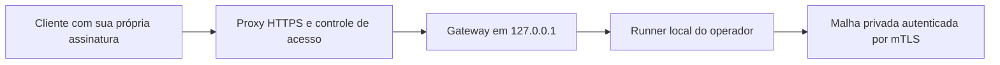

# Gateway de leitura e submissão assinada

`tools/operator-gateway.mjs` conecta uma entrada HTTP local ao runner de um
operador. O processo usa apenas o token de submissão do runner e não carrega
sementes, chaves de contas ou chaves de validadores. O bind do gateway e o
upstream são obrigatoriamente `127.0.0.1`. A instalação do proxy HTTPS, do
domínio e dos servidores é uma etapa de operação separada.



## Configuração local

Crie `gateway.json` no diretório privado do operador. O arquivo referenciado
por `tokenFile` contém o mesmo token hexadecimal de 64 caracteres configurado
em `submitTokenFile` no runner. Mantenha os dois arquivos fora do repositório,
com acesso de leitura apenas para o usuário do serviço.

```json
{
  "schema": "konaet.operator-gateway.v1",
  "port": 58120,
  "upstream": "http://127.0.0.1:58110",
  "tokenFile": "submit.token",
  "publicOrigin": "https://rpc.seu-dominio.example",
  "allowSubmissions": false
}
```

`publicOrigin` é opcional. Ele autoriza somente o cabeçalho `Origin` exato
de uma aplicação servida pelo mesmo domínio HTTPS. O gateway não habilita
CORS. Requisições de ferramentas HTTP sem `Origin` também são aceitas.
`tokenFile` deve ser relativo ao diretório da configuração; caminhos que
escapam desse diretório e links simbólicos são recusados.

```sh
node tools/operator-gateway.mjs /diretorio-privado/gateway.json
curl http://127.0.0.1:58120/api/status
curl http://127.0.0.1:58120/api/genesis
curl http://127.0.0.1:58120/health/ready
```

O processo só imprime o endereço local de escuta. A configuração e o token
não são impressos. `SIGTERM` e `SIGINT` encerram o gateway; conexões que
permanecerem abertas são fechadas em até quatro segundos durante o encerramento.

No proxy HTTPS, reescreva `Host` para o endereço local exato do gateway,
por exemplo `proxy_set_header Host 127.0.0.1:58120;`. Um `Host` externo é
recusado. Aplique limites de conexão, corpo de 64 KiB e tempo de leitura no
proxy, além de controlar acesso à rota de escrita. O token do runner fica
no servidor do gateway; nunca o inclua em HTML, JavaScript ou pedidos dos clientes.

## Endpoints

Para manter o processo ativo em Linux, use o
[serviço do gateway](deploy/validator/konaet-gateway.service) com um usuário
dedicado `konaet-gateway`, fonte conferido em `/opt/konaet` e configuração
em `/etc/konaet/gateway-config.json`. Coloque somente uma cópia do token do
runner nessa pasta; o gateway não precisa de acesso às seeds e ao WAL.
Use proprietário root, grupo `konaet-gateway`, pasta 0750 e arquivos 0640.
O serviço usa Node 24 em `/usr/bin/node` e reinicia em falhas.

O [template Nginx](deploy/validator/nginx-gateway.conf.example) inclui TLS,
limites por IP e autenticação HTTP Basic na rota de submissão. Substitua o
domínio e os caminhos dos certificados e crie o arquivo de clientes com
`htpasswd`; não reutilize o token interno como senha de cliente. Mantenha
`allowSubmissions: false` até concluir essa configuração. O proxy remove
o cabeçalho de autenticação do cliente antes de encaminhar o pedido.

Valide no host Linux antes de ativar:

```sh
sudo systemd-analyze verify /opt/konaet/deploy/validator/konaet-gateway.service
sudo nginx -t
```

Depois instale o serviço em `/etc/systemd/system/`, recarregue systemd e
ative `konaet-gateway.service`. Esses templates não instalam certificados,
criam usuários ou alteram portas automaticamente. Testes de execução dos
serviços e do proxy precisam ocorrer no host que receberá a instalação.

## Endpoints HTTP

| Pedido | Resultado |
|---|---|
| `GET /api/status` | Gênese, rede, sequência, raiz, contagem de contas, conexões e runtime `.ko` |
| `GET /api/genesis` | Gênese pública revalidada pelo gateway |
| `GET /api/account/v7...` | Saldo atômico, nonce, sequência e raiz da conta indicada |
| `GET /api/contract/HASH64` | Artefato e estado do contrato, ambos revalidados; sequência e raiz global |
| `GET /health/ready` | Prontidão local observada, com HTTP 200 ou 503 |
| `POST /api/transactions` | Admissão de um evento canônico já assinado, quando explicitamente habilitada |

Os endereços de conta devem usar o formato completo `v7` seguido de 32
caracteres base32 minúsculos. O identificador do contrato tem 64 caracteres
hexadecimais minúsculos. Não há endpoint de carteira, assinatura, faucet,
proxy arbitrário ou histórico de fechamentos neste gateway. Consultas não
expõem caminhos de WAL, journals, endereços privados de transporte ou o token.

O cliente deve conferir o `genesisId` contra a identidade da rede obtida de
uma fonte confiável. Validar uma gênese demonstra consistência de seus dados;
não demonstra que ela é a rede que o cliente pretendia usar. Uma raiz
retornada por um único endpoint também não substitui um certificado de quórum.

`/health/ready` é uma observação do operador sobre conexões, transações
pendentes e validade do certificado TLS. Não atesta independência dos
administradores, localização das máquinas ou finalização de uma transação.

## Escrita controlada

O padrão `allowSubmissions: false` retorna HTTP 403 para todas as submissões.
O perfil v7 tem capacidade finita, incluindo 128 contratos, e não cobra tarifa
de mercado. Antes de configurar `true`, instale autenticação e regras de
admissão no ingresso HTTPS para evitar ocupação abusiva dessa capacidade.
Uma assinatura válida, sozinha, não é autorização para consumir toda a rede.

Com o ingresso autorizado e `allowSubmissions: true`, envie os bytes
canônicos de `TransferEvent` ou `ContractEvent` Ed25519 do perfil v7:

```sh
curl --request POST \
  --header 'Content-Type: application/octet-stream' \
  --data-binary @evento-assinado.bin \
  http://127.0.0.1:58120/api/transactions
```

O cliente assina usando sua própria chave, a rede correta, o nonce seguinte,
a sequência e a raiz atuais. Chamadas `.ko` também vinculam contrato, método,
argumentos e revisão do estado. O gateway verifica formato canônico e
assinaturas; o runner confere rede, estado, limites e regras de admissão.
Um cabeçalho `Authorization` enviado pelo cliente não é repassado ao runner.
O gateway adiciona o token interno somente ao pedido `/submit`.

HTTP 202 significa apenas:

```json
{"accepted":true,"transactionId":"HASH64","finalized":false}
```

A finalização depende do consenso e de seu certificado. O fluxo de exportação
e reprodução de certificados do console está descrito em [KO-CONSENSUS.md](KO-CONSENSUS.md).
O gateway não transforma uma resposta de admissão em comprovante de finalização.

## Limites e verificação

O processo aplica 120 pedidos e oito submissões por minuto, 16 pedidos
simultâneos, corpo de transação de 64 KiB, resposta upstream de até 8 MiB e
prazos absolutos de cinco segundos para corpo e upstream. O limite de pedidos
é global e também é aplicado pelo endereço TCP; `X-Forwarded-For` é ignorado.
Atrás de um proxy local, os clientes compartilham esse limite global. Limites
por usuário/IP externo pertencem ao proxy autenticado.

Falha, timeout, redirecionamento, JSON inválido ou resposta excessiva do
upstream retornam HTTP 503 sem repassar detalhes internos. O gateway não segue
redirecionamentos nem aceita um upstream fornecido no pedido do cliente.

```sh
node --test tests/operator-gateway.test.mjs
node --test tests/operator-network.test.mjs
```

Os testes cobrem leitura e redação de dados internos, proteção do token,
submissão assinada, escrita desabilitada por padrão, limites de tamanho e
tempo, origens, Host, paths, rate limit e comportamento de indisponibilidade.
O runner da mesma versão precisa oferecer `/genesis` e `/health/ready`;
runners antigos podem responder 503 para essas duas consultas pelo gateway.

O segundo teste requer OpenSSL e usa quatro runners reais com certificados
efêmeros, todos em loopback. Implanta e chama um contrato pelo gateway,
confere três assinaturas por fechamento, observa a perda de quórum e
recupera os mesmos contratos depois de reiniciar os operadores.
