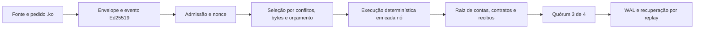

# .ko no consenso VLOCK7SIN v7 e v8

A edição 1.7 cria novas redes de console com o perfil **v8**, protocolo
`0.7.0-sovereign-ko-admission.1`. Ele acrescenta implantação autorizada e
cotas reservadas por endereço, comprometidas na gênese e no estado. As
transações continuam usando os eventos tipados abaixo. O perfil v7 e seus
dados anteriores permanecem legíveis com as mesmas regras.
[Configurar v8 e recuperar falhas](RECOVERY.md).

O perfil `KONAET_KO_PROGRAM_V1` participa de transações tipadas de implantação
e chamada em uma gênese **v7**, com protocolo `0.6.0-sovereign-ko-program.1`.
Cada validador verifica as assinaturas, executa o contrato e recompõe a
mesma raiz antes de votar. O certificado exige três assinaturas em quatro
validadores no perfil inicial.



## Usar no console

Baixe a versão 1.8.0, extraia o pacote Windows e abra `Iniciar-Konaet.bat`.
No código-fonte, execute `npm ci --ignore-scripts` e `npm start`.
O console abre apenas em `127.0.0.1`, inicia quatro processos e usa uma
instância própria em `.konaet-console-v7/`.

1. Abra **Contratos .ko no consenso**.
2. Escolha **Counter.ko** e clique em **Implantar no consenso**.
3. Execute `increment` com `["7"]`: o recibo contém o retorno `14`.
4. Troque a identidade para Bob e repita: o contrato recusa a chamada.
5. Baixe o recibo com certificado e confira-o:

```sh
node tools/verify-contract-receipt.cjs konaet-contrato-recibo.json
```

Para conferir a rede e o ponto de partida pretendidos, use hashes obtidos
por um canal confiável, separado do próprio recibo:

```sh
node tools/verify-contract-receipt.cjs konaet-contrato-recibo.json --genesis-id GENESIS_ID_ESPERADO --previous-root RAIZ_ANTERIOR_ESPERADA
```

Os valores são hashes de 64 caracteres hexadecimais minúsculos. Uma gênese
ou raiz diferente é recusada. O resultado informa `genesisPinned` e
`previousStatePinned`. Sem essas opções, `verified` significa consistência
criptográfica com a gênese incluída; não identifica por si só a rede que o
usuário pretendia consultar. Copiar os hashes do mesmo recibo recebido não
estabelece uma fonte independente de confiança.

O verificador recompila o fonte, verifica os dois níveis de assinatura,
reexecuta o ledger com a política da gênese, confere a raiz e valida o
certificado de quórum. Alterações no evento, estado, eventos emitidos ou
assinaturas invalidam o recibo. O arquivo contém apenas dados públicos da
execução; não contém as sementes das contas ou dos validadores.

Feche pelo botão **Encerrar console** antes de abrir novamente. O WAL
recupera contas, contratos, revisões, recibos e raízes. As instâncias antigas
de `.konaet-demo/` continuam separadas; não há migração automática de gênese.

## Registro e transferência de unidades próprias

O exemplo `RegistryToken.ko` tem emissão pelo dono, transferência, pausa e
consultas de saldo. Após implantar por Alice:

- `mint`: `["ENDERECO_V7_DE_ALICE", "100"]`.
- `transfer`: `["ENDERECO_V7_DE_BOB", "7"]`.
- `setPaused`: `[true]`.

Copie os endereços das contas no console. São unidades do contrato; as
operações não emitem SND nem alteram os ativos da aplicação Konaet.
**Consultar estado** mostra storage e mapas confirmados. Funções `view`
ficam fora dos eventos de escrita do consenso.

## Assinaturas e domínio

O evento de rede tem formato próprio `vlock7sin-ko-event-v1`. Não usa memo
ou uma transferência fictícia para representar um contrato.

O envelope interno vincula programa, contrato, rede, revisão, raiz do
contrato, função, argumentos e limite. A assinatura externa também vincula
o envelope e o fonte ao nonce da conta, à sequência de fechamento e à raiz
global. O chamador é derivado da chave pública. Alterações ou replay de
escrita são rejeitados antes da inclusão no grafo.

## Estado e orçamento

A raiz v7 compromete a raiz de contas, o catálogo de contratos e os recibos
do fechamento. Os recibos incluem identidade, função, retorno, custo e
eventos emitidos. Dois eventos que escrevem no mesmo contrato conflitam;
contratos independentes podem participar do mesmo fechamento.

O seletor reserva o limite assinado de cada chamada, respeita o teto do
fechamento e adia itens que excedam a capacidade do estado. Assim, uma
reserva que não cabe não impede o fechamento dos demais itens válidos.

| Limite v7 | Valor |
|---|---|
| Fonte por implantação | 16 KiB |
| Evento de rede | 64 KiB |
| Orçamento por evento | 100.000 unidades |
| Reserva de orçamento por fechamento | 1.000.000 unidades |
| Contratos | 128 |
| Estado de contratos e recibos | 4 MiB |

Use `parameters.maxActs: 64` e `parameters.maxBytes: 262144` com a política
SND distribuída. Quantidades JSON continuam em strings decimais canônicas.
O orçamento é uma medida de trabalho da VM; não há tarifa de mercado aqui.

## Operação em outras máquinas

O código distribuído inclui `SovereignNode`, o runner de operadores e a
validação da gênese v7. Um roster para contratos usa `contractRuntime` com
o objeto exportado em `chain/vlock7sin-js/src/koConsensusProfile.js`, a
política SND e as chaves públicas dos validadores. Cada operador mantém a
própria chave privada fora do repositório. Configure a malha e mTLS conforme
o [guia de operação](DEPLOYMENT.md).

O perfil v7 inicial usa Ed25519. Os perfis híbridos anteriores permanecem
nas versões anteriores de gênese; v7 recusa ativar um perfil híbrido que
ainda não integra esse novo estado de contratos.

## Estado da publicação

A edição 1.6.0 acrescenta o [gateway de eventos assinados](GATEWAY.md),
prontidão HTTP, supervisão ping/pong dos peers e um
[serviço Linux para operadores](deploy/validator/README.md). A ativação
do gateway começa em modo de leitura; submissões exigem configuração
explícita e controle de acesso na entrada HTTPS. O serviço precisa ser
instalado nos hosts dos operadores para manter os validadores online.

O Studio público em GitHub Pages executa a VM na sessão do navegador.
O console Windows/Node cria redes v8 em quatro processos locais. Diretórios
existentes continuam recuperando sua própria gênese, inclusive v7.
Esses processos têm identidades diferentes, sob a administração de quem
inicia a demonstração. Isso não comprova operação por quatro organizações.

Não há serviço permanente de validadores públicos hospedado nesta release.
Operação pública exige máquinas, armazenamento e conectividade contínuos.
O teste automatizado cobre quórum, atraso de nó, sincronização e recuperação
em loopback; não é uma medição de uma rede geograficamente distribuída.

Os saldos e a gênese da instalação principal Konaet não foram migrados ou
reescritos. Este suporte versionado está disponível para novas instâncias.
