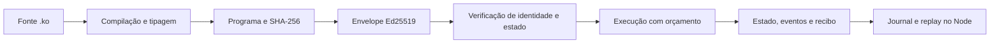

# Contratos .ko com estado

**KONAET_KO_PROGRAM_V1 · distribuição 1.7.2**

[Abrir o .ko Studio](https://7dsol3.github.io/konaet-sovereign-spec/) ·
[Exemplo Counter](chain/ko-program/examples/Counter.ko) ·
[Exemplo RegistryToken](chain/ko-program/examples/RegistryToken.ko)

Este perfil compila funções tipadas, mantém storage e mapas, emite eventos e
executa chamadas com orçamento. A camada de assinatura deriva o chamador da
chave pública Ed25519 e vincula a chamada ao programa, contrato, rede, raiz,
revisão, função, argumentos e limite de execução.



## Usar pelo navegador

1. Abra o Studio e escolha **Counter.ko**.
2. Clique em **Compilar e criar instância**.
3. Execute `increment` com `["7"]`. O resultado será `14`, pois o exemplo
   chama uma função interna que dobra o argumento.
4. Troque a identidade para **Visitante · Bob** e repita: a regra de dono
   rejeita a chamada e preserva a raiz.
5. Use **Baixar recibos** para exportar a sessão.

O Studio roda na memória do navegador, usa WebCrypto para assinar/verificar
e conserva as chaves privadas não exportáveis durante a sessão. Recarregar
descarta as chaves e o estado. O arquivo exportado contém o programa, a
implantação assinada, as chamadas e os recibos; nenhuma chave privada.

Confira a sessão exportada no Node:

```sh
node tools/verify-program-session.mjs Counter-recibos.json
```

Esse comando recompila o programa, confere todas as assinaturas e reexecuta
cada chamada para conferir recibos e a raiz final. Ele comprova a reprodução
da sessão; não atesta um consenso entre operadores.

## Usar com assinatura e persistência no Node

Node.js 24.22.2 ou superior da série 24. No pacote portátil Windows, substitua
`node` por `bin\node.exe`.

```sh
node chain/ko-program/cli.js compile chain/ko-program/examples/Counter.ko Counter.json
```

Configure `KONAET_KO_KEY_PASSPHRASE` com uma senha de pelo menos 12 caracteres
no seu ambiente local. A senha não é argumento da linha de comando.
Não publique a senha, o arquivo de chave ou sua pasta de estado.

No PowerShell, leia a senha sem exibi-la:

```powershell
$koSecret = Read-Host 'Senha da chave .ko' -AsSecureString
$koPointer = [Runtime.InteropServices.Marshal]::SecureStringToBSTR($koSecret)
try { $env:KONAET_KO_KEY_PASSPHRASE = [Runtime.InteropServices.Marshal]::PtrToStringBSTR($koPointer) }
finally { [Runtime.InteropServices.Marshal]::ZeroFreeBSTR($koPointer) }
```

Gere a chave cifrada e crie dois arquivos de configuração:

```sh
node chain/ko-program/cli.js keygen owner.pem
```

`deploy-options.json`:

```json
{"networkId":"77","salt":"0","gasLimit":10000}
```

`increment-request.json`:

```json
{"method":"increment","args":["7"],"gasLimit":10000}
```

Assine, implante e execute:

```sh
node chain/ko-program/cli.js sign-deploy Counter.json deploy-options.json owner.pem signed-deploy.json
node chain/ko-program/cli.js deploy-signed Counter.json counter-state signed-deploy.json
node chain/ko-program/cli.js sign-call counter-state increment-request.json owner.pem signed-call.json
node chain/ko-program/cli.js call-signed counter-state signed-call.json
node chain/ko-program/cli.js status counter-state
```

Apague a variável de senha ao terminar. No PowerShell:

```powershell
Remove-Item Env:KONAET_KO_KEY_PASSPHRASE
```

As chaves usam PKCS#8 cifrado com AES-256-CBC. Arquivos novos são exclusivos;
o utilitário recusa sobrescrever chave, artefato, envelope ou implantação.
Um diretório implantado com assinatura só aceita chamadas assinadas.
Na recuperação, o journal revalida assinaturas e reexecuta o histórico.
Uma chamada de escrita repetida ou com raiz/revisão antiga é rejeitada.
Consultas podem se repetir sobre o mesmo estado, sem criar revisão.

O filesystem controla a disponibilidade e integridade física do journal;
os hashes e assinaturas não impedem seu proprietário de apagar arquivos.
Guarde cópias de segurança da chave cifrada e da pasta completa de estado.

## Linguagem

```ko
contract Example v1
runtime: KONAET_KO_PROGRAM_V1
storage owner: address = caller;
storage total: u128 = 0;
event Changed(actor: address, value: u128);

fn increment(amount: u128) -> u128 {
  require caller == owner;
  set total = total + amount;
  emit Changed(caller, total);
  return total;
}

view fn readTotal() -> u128 { return total; }
end
```

| Recurso | Comportamento |
|---|---|
| Tipos | `u128`, `bool` e `address` v7 canônico |
| Estado | `storage` e `mapping chave => valor` tipados |
| Funções | Públicas, `internal` e `view`; parâmetros e retorno tipados |
| Controle | `let`, `require`, `if/else`, `repeat` constante e `return` |
| Eventos | Definição e emissão com argumentos tipados |
| Aritmética | Inteiros exatos, overflow/underflow e divisão por zero rejeitados |
| Atomicidade | Erro descarta alterações e eventos da chamada |
| Consultas | Não escrevem nem emitem eventos, inclusive por chamadas internas |
| Determinismo | Sem relógio, aleatoriedade, rede, importação ou JavaScript arbitrário |

Quantidades são strings decimais canônicas no JSON. `gasLimit` é um número
inteiro; mede trabalho do interpretador e não representa uma taxa monetária.

## Limites deste perfil

Fonte ASCII/LF até 64 KiB; 8.192 tokens; 4.096 nós de AST; 32 campos de
storage, 16 mapas, 32 eventos e 32 funções; 16 parâmetros; 4.096 entradas
de mapas; 128 eventos por chamada; repetições constantes até 256 e sem
recursão. O orçamento máximo da VM é de 1.000.000 unidades; o Studio limita
a 100.000 e 100 chamadas por sessão.

O journal Node suporta até 1.024 revisões e 10.000.000 unidades acumuladas
de replay, com arquivos até 2 MiB. Uma implantação nova publica fonte,
opções e estado inicial em um único registro exclusivo. Falhas anteriores
à publicação podem ser repetidas em um diretório vazio ou com temporários
não publicados. Implantações válidas nunca são sobrescritas; o formato
anterior com dois arquivos continua legível. Registros completos usam hard
link exclusivo; o filesystem precisa suportar essa operação. Ainda não há
checkpoints ou coleta de histórico nesse utilitário.

## Integração com a rede Konaet

Este perfil de programas é distribuído com o runtime, a CLI, o Studio e o
journal autenticado. Seu estado é separado do ledger SND e da aplicação
SQL: os exemplos não movimentam SND, NAET, KWRK ou KACT existentes.

O perfil **KONAET_KO_ASSERT_V1** permanece nas transferências e fechamentos
do ledger. Na **gênese v7**, o perfil **PROGRAM_V1** também tem transações
próprias: os validadores executam o programa e incluem estado e recibos na
raiz. O console Windows/Node disponibiliza essa execução em quatro
processos, com certificado e replay. [Guia do consenso v7](KO-CONSENSUS.md).
O Studio em GitHub Pages continua executando na sessão do navegador.

O contrato EVM `QuantumRNG.sol` permanece uma implementação distinta. Este
interpretador determinístico não oferece aleatoriedade física ou quântica.

## Verificar a distribuição

```sh
npm test
npm run verify
node tools/build-program-browser.mjs --check
```

Os testes incluem adulteração e repetição de envelopes, permissão do dono,
domínio de rede/contrato, tipagem, overflow, rollback, orçamento, journal,
falhas de disco e assinaturas entre Node.js e WebCrypto. O código do
interpretador do navegador é gerado a partir do mesmo fonte do Node.

SHA-256/SHA3-256 no navegador usam a cópia MIT de `@noble/hashes` 1.3.2,
incluída em [docs/vendor/hashes](docs/vendor/hashes/LICENSE). Ed25519 usa
WebCrypto no navegador e `node:crypto` no Node. Não há CDN de código.
