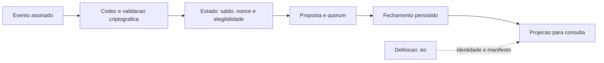

# Perfil público de evento · KNP-002

Edição 1.0.0. Este documento descreve o perfil **EVENT/js-v1** do exemplo
publicado. A versão de um formato de evento difere da versão do transporte
soberano e da edição desta documentação.

## Caminho de autoridade



A assinatura é condição necessária, não suficiente. O nó também precisa
verificar estado, replay, regras de seleção e certificado de finalização. O
verificador desta publicação cobre somente o primeiro estágio criptográfico e
a codificação do perfil abaixo.

## Codificação binária

Inteiros são sem sinal, em ordem big-endian. Valores de 64 e 128 bits são lidos
com `BigInt`; sua forma JSON usa strings decimais. Endereços são ASCII Base32
canônicos, prefixo `v7`, 34 caracteres. Campos variáveis usam comprimento `u16`.
O registro tem limite de 65.536 bytes.

| Ordem | Campo | Tamanho/regra |
|---|---|---|
| 1 | Domínio do evento | ASCII `VLOCK7SIN/EVENT/js-v1` |
| 2 | Magic | ASCII `V7SN` |
| 3 | Tipo | `u8`, valor 2 |
| 4 | Versão de formato | três `u8`: 1, 0, 0 |
| 5 | Versão de protocolo do evento | três `u8`: 0, 2, 0 |
| 6 | Flags | `u16`, valor 0 neste perfil |
| 7 | Rede | `u32`, deve coincidir com a rede esperada pelo verificador |
| 8 | Suíte criptográfica / de estado | dois `u16`, ambos valor 1 |
| 9 | Sequência / nonce / timestamp | três `u64`; sequência e nonce positivos |
| 10 | Quantidade atômica | `u128`, positiva |
| 11 | Raiz anterior | 32 bytes |
| 12 | Chave pública Ed25519 do remetente | 32 bytes |
| 13 | Remetente / destinatário | dois campos ASCII de comprimento `u16` |
| 14 | Quantidade de nexuses | `u16`, máximo 256 |
| 15 | Nexuses | hashes de 32 bytes, únicos e ordenados lexicograficamente |
| 16 | Memo | comprimento `u16` e UTF-8 NFC, máximo 256 bytes; controles proibidos |
| 17 | Assinatura | 64 bytes Ed25519 sobre todos os bytes anteriores |
| 18 | Checksum | primeiros 16 bytes do trace do corpo, incluindo a assinatura |

O trace usa SHA3-256 sobre a concatenação de `VLOCK7SIN/TRACE/js-v1`, tamanho
`u64` do conteúdo e conteúdo. O identificador do evento é o trace do registro
canônico completo, incluindo checksum. O endereço do remetente deriva dos
primeiros 20 bytes de SHA3-256 de `VLOCK7SIN/IDENTITY/v0.1` e chave pública,
codificados em Base32 sem padding com o prefixo `v7`.

O verificador DEVE rejeitar dados excedentes, flags desconhecidas, versões e
suítes diferentes, comprimentos inválidos, nexuses duplicados/desordenados,
memo não canônico, rede divergente, endereço incompatível com a chave,
assinatura inválida e checksum inconsistente.

## Exemplo público

[signed-transfer.json](examples/signed-transfer.json) contém um evento sintético
produzido pelo runtime VLOCK existente, usando identidades novas criadas apenas
em memória. Sua raiz anterior foi escolhida para o exemplo e não representa
uma conta real. Nenhuma chave privada é publicada. O exemplo NÃO foi enviado
à rede e NÃO demonstra saldo nem finalização.

```sh
node tools/verify-transfer.mjs examples/signed-transfer.json
```

O campo `eventIdHex` serve para detectar alterações no vetor, mas pode ser
recalculado por qualquer pessoa. A autenticação do remetente vem da assinatura,
não do hash. O teste de adulteração da assinatura recalcula o checksum para
conferir que a rejeição ocorre também quando a integridade superficial passa.

## `.ko` e execução

O parser `.ko` existente reconhece cabeçalhos, metadados, blocos de campos,
eventos declarados e regras textuais. Preserva quantidades decimais como texto,
recusa duplicatas e gera manifestos com `executable: false` e
`executableConsensus: false`.

Não existe chamada ao parser `.ko` no caminho de serialização e validação
VLOCK observado. Tornar uma regra `.ko` executável requer uma especificação de
semântica, limites de execução, versionamento, ativação por consenso e testes
diferenciais. Esta edição não cria tal máquina virtual.

## Quórum e independência

No perfil permissionado observado, quatro validadores exigem três assinaturas
elegíveis. Chaves distintas no mesmo computador não constituem quatro
administrações independentes. Finalização depende das hipóteses do protocolo,
da integridade dos operadores e do tratamento correto das falhas. Não se
deduz resistência geral a falhas bizantinas de um único cenário de teste.

Uma configuração de rede também pode exigir assinaturas híbridas. O exemplo
EVENT/js-v1 aqui publicado tem assinatura Ed25519; não inclui o envelope de
autorização híbrida nem prova do transporte ou do quórum.
