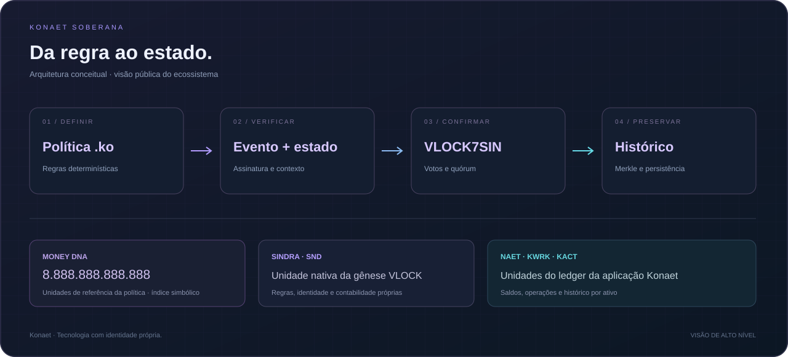
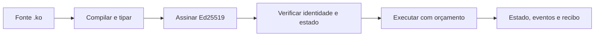
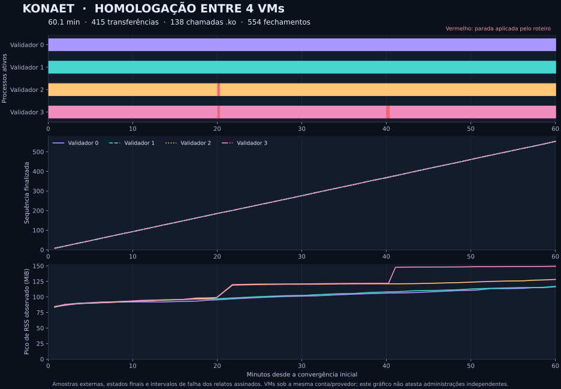

<div align="center">
  

  <p><a href="https://konaet-ko-runtime.alkalipixie.chatgpt.site">Ecossistema Konaet</a> · <a href="https://7dsol3.github.io/konaet-sovereign-spec/">.ko Studio</a> · <a href="KO-PROGRAM.md">Criar contratos</a> · <a href="https://wa.me/message/43CXZJ7NW2FPDO">Projetos e parcerias</a></p>
</div>

# Konaet Soberana

**Native Chain · Console 1.7.1 · .ko Studio · Consenso v8**

Nós VLOCK7SIN, transações assinadas, consenso por quórum, sincronização,
persistência WAL e regras nativas `.ko`. Esta edição publica o código dos nós
e um console que inicia quatro processos validadores no seu computador.

[.ko Studio online](https://7dsol3.github.io/konaet-sovereign-spec/) ·
[Baixar para Windows](https://github.com/7dsol3/konaet-sovereign-spec/releases/latest/download/Konaet-Console-Windows-x64.zip) ·
[Releases](https://github.com/7dsol3/konaet-sovereign-spec/releases)



## Contratos .ko com estado e assinatura

O perfil **KONAET_KO_PROGRAM_V1** executa funções tipadas, storage, mapas,
eventos e chamadas internas, com inteiros `u128`, orçamento e rollback.
Chamadas Ed25519 vinculam o programa, o contrato, a rede e o estado ao pedido.
O journal Node revalida assinaturas e reproduz as transições ao recuperar.

Abra o **[.ko Studio](https://7dsol3.github.io/konaet-sovereign-spec/)**,
crie uma instância de `Counter.ko` e execute `increment` com `["7"]`.
O Studio roda no navegador e exporta recibos que o Node verifica e reproduz.
[Guia completo, exemplos e chave cifrada](KO-PROGRAM.md).



Na **gênese v7**, esse perfil participa de transações tipadas de implantação
e chamada. Cada validador executa o programa; contas, contratos e recibos
entram na raiz antes do voto e da persistência. O console roda quatro
processos e exporta recibos com certificado de quórum.
[Usar contratos no consenso](KO-CONSENSUS.md).

Novas redes do console usam a **gênese v8**: permissões de implantação e cotas
por participante ficam comprometidas na gênese e na raiz do estado. Uma conta
não autorizada não ocupa o catálogo de contratos. Redes v7 existentes mantêm
suas regras e seus dados; não há migração automática de saldos ou gênese.
[Recuperação, capacidade e mudanças da edição 1.7](RECOVERY.md).

A edição 1.7.1 retoma automaticamente trabalho pendente quando o quórum
volta a se conectar. A homologação inclui VMs separadas com mTLS de ponta
a ponta, perda de quórum e recuperação de processo interrompido.
[Roteiro e critérios verificáveis](REMOTE-VALIDATION.md).

**Homologação de uma hora concluída:** quatro VMs Ubuntu, 415 transferências,
138 chamadas `.ko`, 554 fechamentos e a mesma raiz final. O roteiro incluiu
perda/retorno do quórum e SIGKILL com recuperação do estado.
[Resultados, relatos assinados e reprodução](VALIDATION-RESULTS.md).



Ao conferir um certificado recebido, fixe a identidade da rede com
`--genesis-id` e, quando disponível, a raiz anterior com `--previous-root`.
Essas referências devem vir de um canal confiável independente do recibo.
[Assinaturas, certificados e referências de confiança](KO-CONSENSUS.md#usar-no-console).

O Studio público executa a VM no navegador. O console Windows/Node executa
o consenso na sua instância local. Os saldos existentes da instalação
principal Konaet não são migrados para esses exemplos.

## Operação e entrada HTTPS

O [gateway](GATEWAY.md) consulta gênese, contas e contratos e encaminha
eventos já assinados para um operador. A chave de assinatura permanece
com quem envia a transação. Há limites de tamanho, tempo, concorrência e
requisições; o token privado do operador fica no servidor.

O gateway inicia em modo de leitura. Ative submissões somente atrás de
uma entrada autenticada. Consulte a [instalação do serviço Linux](deploy/validator/README.md)
para manter o processo do validador ativo, reiniciar em falhas e preservar
seu WAL. A prontidão verifica conectividade suficiente para quórum,
trabalho pendente e expiração de certificados. A malha supervisiona os
peers com ping/pong e encerra conexões que deixam de responder.

O teste de integração executa quatro operadores com mTLS, passa implantação
e chamada `.ko` pelo gateway, confere certificados e testa perda de quórum
e recuperação. O ensaio ocorre em loopback; os hosts externos continuam
dependendo da instalação pelos operadores.

## Identidade do ecossistema

| Ativo | Papel |
|---|---|
|  **SINDRA · SND** | Unidade da gênese VLOCK7SIN, com política .ko e nove casas decimais |
|  **NAET** | Unidade do ledger da aplicação Konaet |
|  **Konaet Work · KWRK** | Unidade de trabalho do ecossistema |
|  **Konaet Actum · KACT** | Unidade ligada à execução contabilizada pela aplicação |

**Money DNA:** `8.888.888.888.888` unidades simbólicas de referência da
política, com significado distinto de saldo financeiro ou cotação.
[Conheça as identidades e os fluxos](ECOSYSTEM.md).

## Seu primeiro projeto .ko

```sh
npm ci --ignore-scripts
npm run ko -- init minha-politica
npm run ko -- run minha-politica/SindraRuntime.ko minha-politica/transfer.json
npm run ko -- online minha-politica/SindraRuntime.ko minha-politica/transfer.json
```

O projeto inclui fonte, contexto de transferência e contexto de fechamento.
[Guia com exemplos, artefatos compilados e integração](KO-QUICKSTART.md).

## Usar no Windows

1. Baixe **Konaet-Console-Windows-x64.zip** nos assets da release 1.7.1.
2. Clique com o botão direito → **Extrair tudo**.
3. Abra a pasta extraída e dê dois cliques em **Iniciar-Konaet.bat**.

O navegador abre o console. Envie SND de teste entre Alice e Bob, acompanhe
os quatro processos, os fechamentos, a raiz e o histórico. O console também
compila e executa `.ko`. Use **Encerrar console** para parar os validadores.
Ao abrir novamente, a rede recupera os dados do WAL.

Em **Contratos .ko no consenso**, implante `Counter.ko` ou `RegistryToken.ko`,
execute funções e exporte o certificado. Confira-o com
`node tools/verify-contract-receipt.cjs RECEIPT.json`.

O ZIP inclui Node.js: não precisa instalar Node, npm ou configurar um roster.
As chaves de demonstração são geradas na primeira execução, dentro de
`.konaet-console-v7/`. Os saldos de demonstração não têm valor monetário e são
separados dos saldos da sua carteira Konaet.

O download automático **Source code (zip)** do GitHub é o código-fonte.
O aplicativo pronto para Windows é o asset **Konaet-Console-Windows-x64.zip**.

## Executar pelo código — Windows, Linux e macOS

Com Node.js 24.22.2 ou superior da série 24:

```sh
git clone https://github.com/7dsol3/konaet-sovereign-spec.git
cd konaet-sovereign-spec
npm ci --ignore-scripts
npm start
```

A única dependência é a cópia de runtime da biblioteca WebSocket `ws`, incluída
em `vendor/ws` com licença MIT. `npm ci` instala essa cópia local.
Para usar sem abrir o navegador automaticamente:

```sh
node tools/console.mjs --no-browser
```

## O que roda

| Componente | Código | Comportamento |
|---|---|---|
| Nó VLOCK7SIN | [SovereignNode.js](chain/network/sovereign/SovereignNode.js) | Recebe eventos, troca votos, finaliza por quórum e sincroniza peers |
| Ledger | [ledger.js](chain/vlock7sin-js/src/ledger.js) | Confere assinatura, saldo, nonce, estado e política `.ko` |
| Runtime `.ko` | [koPolicy.js](chain/vlock7sin-js/src/koPolicy.js) | Compila e executa nove regras padrão com inteiros exatos |
| Programas `.ko` | [runtime.js](chain/ko-program/runtime.js) | Compila funções, storage, mapas e eventos com orçamento e rollback |
| Chamadas assinadas | [auth.js](chain/ko-program/auth.js) | Ed25519, endereço derivado da chave, domínio e proteção contra replay de escritas |
| Journal de contratos | [store.js](chain/ko-program/store.js) | Persistência exclusiva e replay autenticado |
| Consenso de contratos v7 | [koState.js](chain/vlock7sin-js/src/koState.js) | Estado e recibos comprometidos na raiz, execução em cada validador e replay WAL |
| Evento de contrato | [contractEvent.js](chain/vlock7sin-js/src/contractEvent.js) | Envelope e assinatura externa vinculam programa, rede, nonce e raiz global |
| Gênese v6 | [SovereignGenesis.js](chain/network/sovereign/SovereignGenesis.js) | Vincula fonte e programa `.ko` à identidade da rede |
| Persistência | [persistence.js](chain/vlock7sin-js/src/persistence.js) | WAL, snapshots e recuperação do estado |
| Console | [console.mjs](tools/console.mjs) | Interface HTTP local, transferências assinadas e quatro processos |
| Operador | [runIndependentValidator.js](chain/scripts/runIndependentValidator.js) | Identidade individual, mTLS e configuração de malha privada |

O console online executa políticas sobre o contexto informado. O console
Windows executa também os nós e as transferências da sua própria rede local.
Operadores em outras máquinas usam o [guia de operação](DEPLOYMENT.md).

## Testar o funcionamento

```sh
npm test
npm run verify
```

O teste de integração inicia quatro processos distintos, envia transações
assinadas, verifica convergência, rejeita gasto sem saldo, encerra os processos
e recupera os mesmos saldos e raiz depois de reiniciar. Também testa o bloqueio
de requisições sem autorização local e a aplicação de `.ko`.
O CI executa os testes em Windows e Linux.
`npm run verify` também confere versões dos pacotes, manifesto e links
relativos da documentação, incluindo as imagens HTML no README.
Depois de editar um arquivo distribuído, execute `npm run manifest` e
`npm run verify` antes de publicar.

## Executar `.ko` pela linha de comando

```sh
npm run ko -- compile runtime/SindraRuntime.ko
npm run ko -- run runtime/SindraRuntime.ko examples/ko-transfer-context.json
npm run ko -- online runtime/SindraRuntime.ko examples/ko-transfer-context.json
```

O comando `online` executa na API pública e confere o hash do programa
retornado. [Formato, contexto e comandos](KO-RUNTIME.md).

## Documentação

- [Operação e separação entre demonstração e rede pública](DEPLOYMENT.md)
- [Comece com .ko](KO-QUICKSTART.md)
- [Ecossistema, ativos e Money DNA](ECOSYSTEM.md)
- [Runtime .ko e formato da política](KO-RUNTIME.md)
- [Nomenclatura Konaet](NOMENCLATURE.md)
- [Perfil de evento assinado](PROTOCOL.md)
- [Testes, resultados e escopo](EVIDENCE.md)
- [Segurança](SECURITY.md) e [licença ISC](LICENSE)

O manifesto de distribuição confere a integridade dos arquivos publicados.
Consulte a [arquitetura e os recursos da Konaet](COMPARISON.md) para acompanhar
o caminho do fonte `.ko` até a execução pelos validadores.

Projeto de [7dsol3](https://github.com/7dsol3). As edições anteriores permanecem
nas tags.
