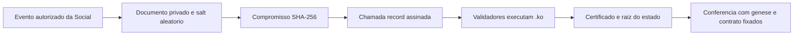

# Recibos da Konaet Social

O contrato `SocialReceiptRegistry.ko` registra compromissos SHA-256 com
autorização do proprietário, numeração crescente e limite de 128 registros
por instância. O SDK usa um salt aleatório de 32 bytes e um domínio próprio.
O compromisso de 256 bits é dividido em dois `u128`, sem truncamento e sem
alterar o formato ou as regras de redes existentes.



## Usar o SDK

```js
const { createSocialOpening, createSocialCommitment, verifySocialReceipt }
  = require('./tools/social-receipt.cjs');

const opening = createSocialOpening({
  schema: 'konaet.social.post.v1', contentDigest: 'a'.repeat(64)
});
const request = createSocialCommitment(opening);
// Guarde opening em armazenamento privado. Nunca envie opening ao contrato.
// Envie somente request.args para record no SocialReceiptRegistry implantado.
const result = verifySocialReceipt(bundle, {
  expectedGenesisId: trustedGenesisId,
  expectedContractId: trustedContractId,
  expectedCommitment: request.commitment
});
```

A verificação exige a identidade esperada da rede, o contrato esperado,
o código do registro distribuído nesta edição, as assinaturas de quórum,
a reexecução e a inclusão do compromisso na chamada finalizada.
Um certificado válido de outra rede ou de outro contrato é rejeitado.
O recibo confirma inclusão e finalização; não confirma a veracidade do
conteúdo, titularidade jurídica ou qualidade de uma decisão de IA.

O documento e o salt ficam fora da cadeia. O endereço público do signatário
e os compromissos ficam no registro. Revele uma abertura somente quando
quiser permitir a conferência daquele documento.

## Redes existentes

A integração deve fixar uma gênese compatível com contratos `.ko` e um
registro autorizado. Não converte saldos SQL, não migra a gênese da carteira
e não registra conteúdo privado automaticamente. A instância local usa
diretório próprio e unidades sem valor monetário.

`node --test tests/social-receipt.test.mjs` exercita quatro processos
validadores, escrita autorizada, preservação de saldos, certificado,
adulteração, referências de confiança e recuperação após reinício.
