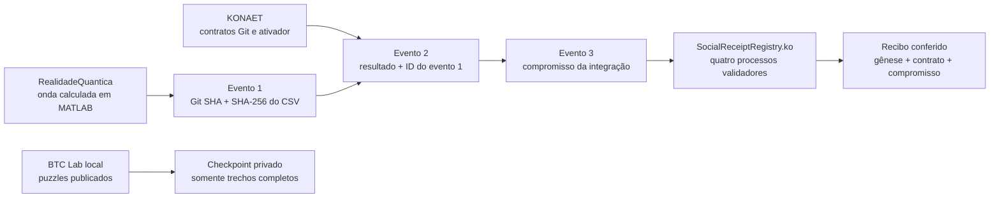

# KONAET — três projetos, uma trilha verificável

[RealidadeQuantica](https://github.com/7dsolv/RealidadeQuantica) calcula os
experimentos. [KONAET](https://github.com/7dsolv/konaet-bot) valida contratos
de automação e autentica a App nos repositórios em que está instalada.
Esta especificação recebe compromissos de execução e verifica sua inclusão
em recibos `.ko` usando o runtime já existente.



O [workflow](../.github/workflows/ecosystem.yml) fixa as revisões dos outros
dois projetos. Executa o pacote de onda do laboratório, os 52 contratos Git e
os 19 testes do ativador, produz três eventos encadeados em MATLAB e leva o
último compromisso ao contrato real em quatro processos locais. O harness
Node original é reutilizado sem alterações; recebe o vetor desta execução,
e o arquivo de vetores original é restaurado mesmo se o teste falhar.

Os novos módulos de cálculo são MATLAB. A especificação já usa Node, `.ko`
e outros clientes; o BTC Lab C# fornecido no workspace foi importado sem
alterar seus bytes. YAML e PowerShell fazem a integração operacional.
Não foi criada outra interface HTML/JavaScript para o laboratório.

## Reproduzir

Com os três checkouts, MATLAB, Node e as dependências existentes instaladas:

```matlab
addpath('ecosystem/matlab');
test_ecosystem(pwd, '../RealidadeQuantica', '../konaet-bot', fullfile(pwd,'artifacts/ecosystem'));
```

Os testes Git exigem Linux. Depois, execute o verificador de finalização:

```powershell
./ecosystem/Test-KonaetReceipt.ps1 -OutputDirectory artifacts/ecosystem
```

O artefato do workflow contém `ecosystem-report.json`, o CSV calculado,
relatórios do bot, `receipt-vector.json`, `sovereign-finality.json`, a imagem
e o GIF gerados em MATLAB. A animação ilustra a execução registrada; não é
telemetria ao vivo.

## Contrato de evidência

Todos os identificadores são strings: SHA Git completo, SHA-256 completo,
ID da execução e tentativa em decimal exato. Repositório, nomes, tipos,
tamanhos e caracteres são validados. O documento canônico tem campos ASCII
ordenados. Seu ID é `SHA256("KONAET/RUN-EVENT/v1" || 00 || documento)`.
O campo `parentEventId` inclui o ID anterior; o primeiro usa 64 zeros.
O compromisso segue exatamente [KRP-0001](../polyglot/spec/KRP-0001.mediawiki),
incluindo domínio, salt de 32 bytes e divisão em dois `u128` sem arredondar.
As aberturas publicadas contêm somente metadados públicos e hashes.

O recibo comprova inclusão e finalização na rede de teste identificada.
Não transforma metadados em fatos verdadeiros, não autentica uma App que
não participou da execução e não comprova superioridade geral. Esta ponte
exercita a finalização existente; não anuncia segurança pós-quântica nova.
Cada operador deve fixar a gênese e o contrato confiáveis antes de aceitar
recibos de outra instalação. Veja [recibos](../SOCIAL-RECEIPTS.md).

## Puzzles

O [BTC Lab](../btc-lab/README.md) separa testes conhecidos de buscas por
prêmios. O processo de busca é local, limitado a uma sessão de até 60 minutos,
um worker e um catálogo fixado. Não há agendamento de busca por recompensas
em runners hospedados. O CI apenas compila, executa vetores conhecidos e
confere a política de checkpoint.

Os arquivos extras `rea-main` e `Konaet-Secrets` do workspace não fazem parte
desta integração ou de sua distribuição.
