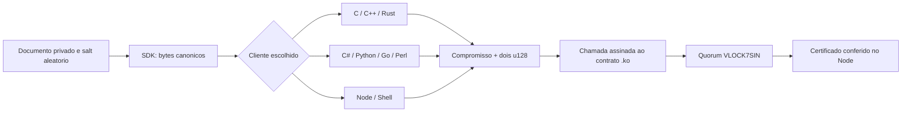

# Konaet Polyglot Receipt Kit

**Um compromisso de 256 bits. O mesmo resultado em sete linguagens, Node.js e Shell.**

Este kit prepara os argumentos de `SocialReceiptRegistry.ko` e confere uma
abertura do compromisso. Não acessa chaves, não se conecta à rede e não
transfere moedas. Cada teste de integração envia o resultado de um cliente
ao contrato real em quatro processos validadores e confere seu certificado
com o verificador de finalização Node já distribuído.



## Implementações

| Linguagem | Entrada | Dependência criptográfica |
|---|---|---|
| C11 | [receipt.c](c/receipt.c), [API C](c/receipt.h) | OpenSSL EVP SHA-256 |
| C++17 | [receipt.cpp](cpp/receipt.cpp) | OpenSSL EVP SHA-256, gerenciamento RAII |
| C# / .NET 8 | [Program.cs](csharp/Program.cs) | SHA-256 e BigInteger do .NET |
| Python 3 | [receipt.py](python/receipt.py) | hashlib, hmac e inteiros nativos |
| Rust | [main.rs](rust/src/main.rs) | RustCrypto sha2 0.10.9, dependências fixadas no lock |
| Perl 5 | [receipt.pl](perl/receipt.pl) | Digest::SHA, JSON::PP e Math::BigInt |
| Go | [main.go](go/main.go) | crypto/sha256 e math/big da biblioteca padrão |
| JavaScript / Node | [receipt.cjs](node/receipt.cjs) | node:crypto e BigInt |
| Shell POSIX | [receipt.sh](shell/receipt.sh) | Executa a implementação C compilada |
| Wikitext | [KRP-0001.mediawiki](spec/KRP-0001.mediawiki) | Especificação documental |
| TeX | [krp-0001.tex](spec/krp-0001.tex) | Formulação matemática documental |

C e C++ têm parsers e conversões próprios; compartilham a biblioteca
criptográfica OpenSSL. Shell é uma entrada de operação para C, não uma
nona implementação independente de SHA-256. Bibliotecas e licenças
permanecem identificadas em [dependências](DEPENDENCIES.md).

## Executar

Exporte uma abertura privada produzida pelo SDK. O arquivo de saída contém
o salt e os bytes do documento; guarde-o como dado privado e não o publique
em logs ou issues. Não use os salts dos vetores públicos em dados reais.

```sh
node polyglot/node/export-frame.cjs PRIVATE_OPENING.json > private-frame.txt
python3 polyglot/python/receipt.py < private-frame.txt
go run polyglot/go/main.go < private-frame.txt
perl polyglot/perl/receipt.pl < private-frame.txt
```

Compile clientes nativos com as ferramentas da sua plataforma:

```sh
cc -std=c11 -O2 polyglot/c/receipt.c -lcrypto -o /tmp/konaet-receipt-c
c++ -std=c++17 -O2 polyglot/cpp/receipt.cpp -lcrypto -o /tmp/konaet-receipt-cpp
sh polyglot/shell/receipt.sh /tmp/konaet-receipt-c < private-frame.txt
cargo run --locked --release --manifest-path polyglot/rust/Cargo.toml < private-frame.txt
dotnet run --project polyglot/csharp/Konaet.Receipt.csproj < private-frame.txt
```

O frame é ASCII com exatamente três linhas terminadas por LF:

```text
salt: 64 caracteres hexadecimais minúsculos
documento canônico: 4 a 32768 caracteres hexadecimais, comprimento par
compromisso esperado: 64 caracteres hexadecimais minúsculos, ou -
```

As descrições acima não são prefixos: cada linha contém somente o valor.
O resultado é JSON com `commitment`, `args: [high, low]` em decimais exatos
e `matches`. Código de saída 0 significa cálculo ou comparação aprovada;
1 indica divergência; 2 indica entrada inválida. `matches: null` indica
cálculo sem referência esperada. Confira o protocolo em
[Wikitext](spec/KRP-0001.mediawiki).

Os clientes tratam o documento como bytes opacos já canonizados pelo SDK.
Eles não reimplementam a normalização JSON do JavaScript. Alterar espaço,
Unicode, ordem ou números muda os bytes e pode mudar o compromisso.

## Testar e integrar

```sh
npm ci --ignore-scripts
node polyglot/conformance.mjs python
node polyglot/conformance.mjs c
node polyglot/conformance.mjs cpp
node polyglot/conformance.mjs csharp
node polyglot/conformance.mjs rust
node polyglot/conformance.mjs perl
node polyglot/conformance.mjs go
node polyglot/conformance.mjs shell
node polyglot/conformance.mjs node
```

O harness compila fora da árvore de fontes, compara 12 vetores canônicos,
exercita cálculo/comparação/divergência, rejeita 20 frames malformados,
verifica o limite de 16 KiB e finaliza um registro real em quatro processos.
C e C++ são executados com AddressSanitizer e UndefinedBehaviorSanitizer.
As versões das ferramentas entram no relatório de cada execução.

`KONAET_POLYGLOT_REPORT` define o arquivo de resultado.
`KONAET_TOOL_CC`, `KONAET_TOOL_CXX`, `KONAET_TOOL_DOTNET`, `KONAET_TOOL_CARGO`,
`KONAET_TOOL_GO`, `KONAET_TOOL_PYTHON`, `KONAET_TOOL_PERL` e `KONAET_TOOL_SH`
permitem selecionar os executáveis instalados.

Este kit valida abertura e compatibilidade do compromisso. Para conferir
assinaturas, execução e finalização, use [verifySocialReceipt](../SOCIAL-RECEIPTS.md)
com gênese e contrato esperados, obtidos por canal confiável.

## Operadores e autoria

Copiar um cliente ou iniciar uma rede própria não autoriza entrar na sua
instância: a gênese e as identidades de validadores determinam quem pode
votar, e o contrato confere o signatário autorizado a registrar. A chave
privada do operador não faz parte deste kit. A licença ISC existente
continua permitindo uso, cópia e modificação com suas condições de atribuição.
Contributors é um registro de participações, não um mecanismo de permissão.
